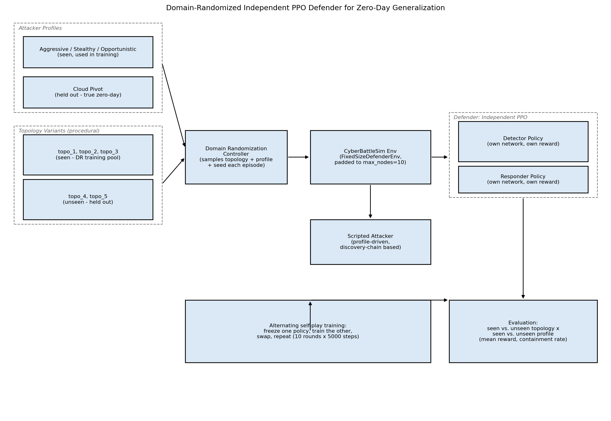
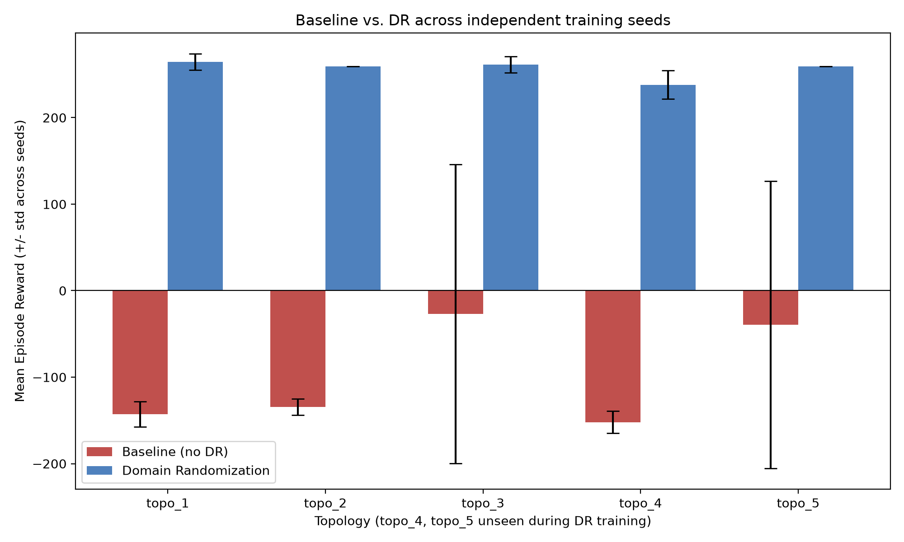
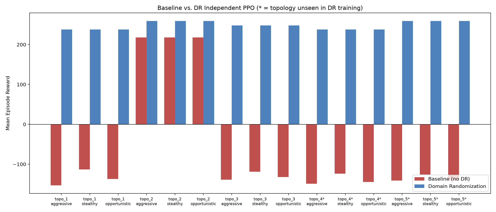

# Structural and Attack-Mechanism Generalization in a Domain-Randomized Detector–Responder Framework for Autonomous Cyber Defense

Official code, results and documentation for the paper accepted to **IEEE ICCIT 2026** (29th International Conference on Computer and Information Technology, Paper ID 648, oral presentation).

📄 Paper: [`paper/manuscript_ICCIT2026.pdf`](paper/manuscript_ICCIT2026.pdf)

## TL;DR

Most MARL cyber defenders are trained and tested on one fixed network against one fixed attacker, so it is unclear whether they generalize or memorize. We train an **Independent-PPO Detector/Responder** pair in Microsoft's [CyberBattleSim](https://github.com/microsoft/CyberBattleSim) under **domain randomization (DR)** over procedurally generated topologies and three attacker profiles, and compare it with a matched fixed-scenario baseline over 3 training seeds, on a full seen/unseen matrix (two held-out topologies, one held-out *cloud-pivot* attack mechanism).

| Finding | Evidence |
|---|---|
| DR defender contains the attacker (100 %, positive reward) on **every seen-attacker condition, including both unseen topologies** | [Table II](docs/RESULTS.md#table-ii--single-run-seenunseen-matrix) |
| Fixed-scenario baseline fails on most topologies and varies hugely across seeds (std up to 172.7) | [Table III](docs/RESULTS.md#table-iii--multi-seed-topology-generalization-aggressive-profile) |
| **Both** defenders collapse equally (−107.0, 0 % containment) against the held-out cloud-pivot mechanism, a hard limit of topology/behaviour-level DR | [RESULTS.md](docs/RESULTS.md) |



| Multi-seed (mean ± std, 3 seeds) | Per-condition reward |
|---|---|
|  |  |

## Repository layout

```
├── src/cyberdr/            # the library
│   ├── topology.py         # procedural topology generator + topo_1..topo_5 definitions
│   ├── handcrafted.py      # hand-authored topology A (baseline only)
│   ├── profiles.py         # attacker profiles (aggressive / stealthy / opportunistic / cloud_pivot)
│   ├── multi_agent_env.py  # scripted attacker + Detector/Responder step logic, reward (Eq. 2)
│   ├── fixed_size_env.py   # pads obs/actions to 10 nodes so one policy spans all topologies
│   ├── role_env.py         # single-role view with the partner policy frozen (IPPO)
│   ├── dr_controller.py    # samples (topology, profile, seed) every training episode
│   ├── training.py         # alternating IPPO loop (10 rounds x 5,000 steps per role)
│   └── evaluation.py       # deterministic evaluation: reward, containment rate
├── scripts/                # train.py · evaluate.py · make_figures.py · make_architecture_diagram.py
├── tests/                  # invariants (held-out data never leaks into training, determinism, ...)
├── results/                # paper_table2_single_seed.csv, paper_multiseed_results.json, figures/
├── docs/                   # METHODOLOGY.md · RESULTS.md · REPRODUCIBILITY.md
├── notebooks/              # colab_quickstart.ipynb + archive/ (original development notebook)
└── paper/                  # accepted manuscript (PDF)
```

## Quick start

Requires **Python 3.10–3.12** (CyberBattleSim pins `numpy==1.26.4`, which has no 3.13 wheels). CPU is sufficient.

```bash
git clone https://github.com/donti507/domain-randomized-ippo-cyber-defense.git
cd domain-randomized-ippo-cyber-defense
python -m venv .venv && source .venv/bin/activate
pip install -r requirements.txt && pip install -e .

pytest -q                                              # sanity / invariant tests

python scripts/train.py --method baseline --seeds 0 1 2
python scripts/train.py --method dr       --seeds 0 1 2
python scripts/evaluate.py --mode matrix    --seed 0   # full seen/unseen matrix (Table II style)
python scripts/evaluate.py --mode multiseed            # Table III
python scripts/make_figures.py results                 # regenerate figures from the saved paper results
```

Or open [`notebooks/colab_quickstart.ipynb`](notebooks/colab_quickstart.ipynb) in Google Colab.

To only inspect the numbers reported in the paper, no training is needed: see [`results/`](results/) and [`docs/RESULTS.md`](docs/RESULTS.md).

## Method in one paragraph

State `s_t = [o_1,f_1,…,o_N,f_N]` (node *occupied by attacker*, node *flagged*). The **Detector** flags a node; the **Responder** re-images a node (evicting the attacker). Reward `r_t = 5·I_cf + 20·I_sr − c_atk(t) − 100·I_cj`; the episode ends with −100 if the crown jewel is compromised and counts as *contained* if it survives 50 steps. Topologies are random rooted trees (7–10 nodes); the deepest node is the crown jewel. Training pool: `topo_1–3` × {aggressive, stealthy, opportunistic}. Held out: `topo_4–5` and the `cloud_pivot` attacker, which uses a `CloudIAMPivot` vulnerability plus a `DiscoverCloudMisconfig` shortcut from the entry point straight to the crown jewel. Details: [`docs/METHODOLOGY.md`](docs/METHODOLOGY.md).

## Reproducibility notes (please read)

* Table III is regenerated by `scripts/train.py` + `scripts/evaluate.py --mode multiseed` using seeds 0, 1, 2 (DR-controller seed = 7 + seed).
* Table II in the paper came from an earlier, **unseeded** training run in the development notebook; re-running with seed 0 gives the same qualitative picture but not necessarily identical per-cell numbers. Both sets are documented in [`docs/REPRODUCIBILITY.md`](docs/REPRODUCIBILITY.md), together with a map from the original notebook to this code.
* A clean-checkout re-run (details in `docs/REPRODUCIBILITY.md`) reproduces the baseline numbers exactly and the DR behaviour (100 % containment on seen profiles incl. unseen topologies; −107.0 / 0 % on `cloud_pivot` for both), with DR rewards differing by up to ~20 points on some topologies. Outputs: `results/reproduction/`.
* The paper's saved numbers live in `results/paper_*`; fresh runs write to `results/matrix_seed*.csv` and `results/multiseed_results.json` so they never overwrite them.

## Limitations

Small simulated networks (7–10 nodes), scripted (non-learning) attackers, one MARL algorithm (IPPO), deterministic evaluation of 20 episodes per condition. See Section 6 of the paper.

## Citation

```bibtex
@inproceedings{TODO_key_2026,
  title     = {Structural and Attack-Mechanism Generalization in a Domain-Randomized Detector-Responder Framework for Autonomous Cyber Defense},
  author    = {<AUTHORS>},
  booktitle = {29th International Conference on Computer and Information Technology (ICCIT)},
  year      = {2026}
}
```
(`CITATION.cff` is provided too; update the DOI/proceedings details once IEEE Xplore lists the paper.)

## License

MIT, see [`LICENSE`](LICENSE). CyberBattleSim is © Microsoft, MIT licensed, and is installed as a dependency, not redistributed here.

